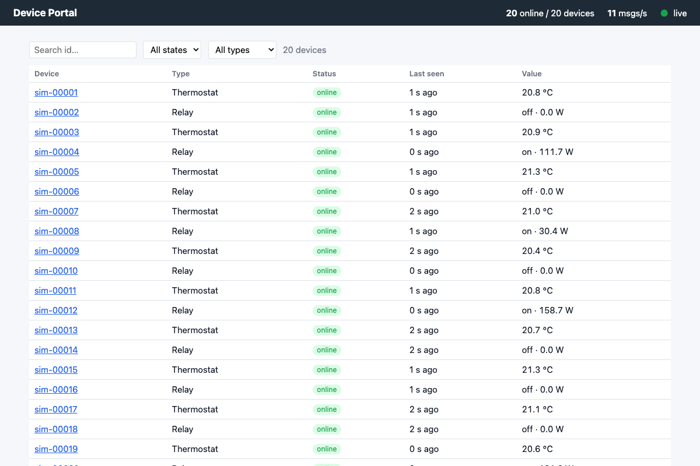
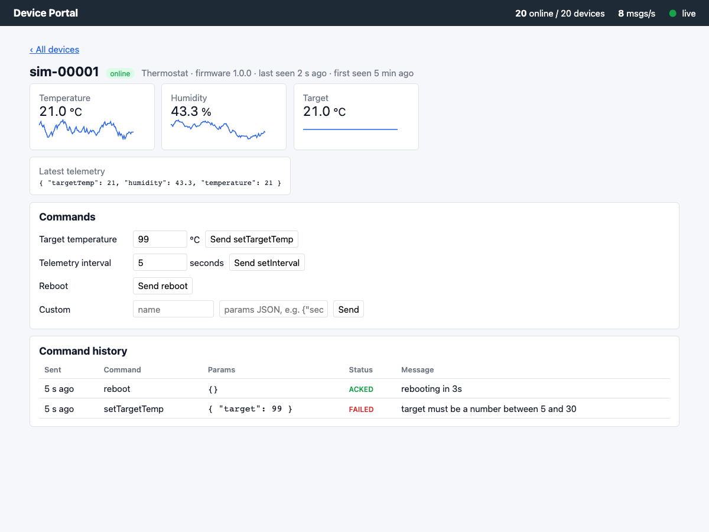
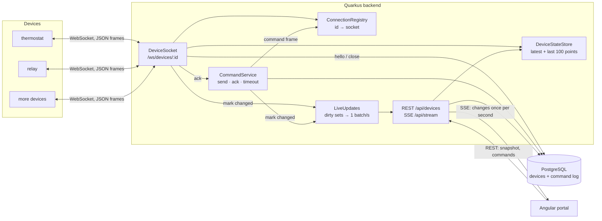

# IoT Device Management

A small system that keeps **thousands of devices connected over persistent WebSockets**, shows
them **live in a web portal**, and sends them **commands with delivery feedback**.

- **Backend:** Quarkus (Java 21), WebSockets Next, REST + SSE, Hibernate Panache, PostgreSQL
- **Portal:** Angular (standalone components, signals), plain CSS, no UI library
- **Simulator:** plain Java, N virtual thermostats/relays in one JVM




## Quickstart

Needs JDK 21+, Node 20+, Docker (for Postgres via Quarkus Dev Services). Three terminals, each
from the repo root:

```bash
cd backend && ./mvnw quarkus:dev                                                  # 1. backend on :8080 (starts its own Postgres)
cd simulator && ./mvnw -q package && java -jar target/simulator.jar --count 100   # 2. 100 devices
cd portal && npm install && npm start                                             # 3. portal on http://localhost:4200
```

With Colima instead of Docker Desktop, export these before step 1:
`DOCKER_HOST=unix://$HOME/.colima/default/docker.sock` and
`TESTCONTAINERS_DOCKER_SOCKET_OVERRIDE=/var/run/docker.sock`.

Simulator options: `--count`, `--interval <s>`, `--ramp <devices/s>`, `--prefix`, `--types thermostat,relay`, `--url`.

## Architecture



- **Devices → backend:** `hello` (type, firmware), `telemetry` (every few seconds), `ack`.
  Telemetry stays **in memory** (ring buffer of 100 points per device). Postgres is written only
  on connect/disconnect and for commands.
- **Backend → devices:** `command` with a `commandId`. Status `PENDING → SENT → ACKED / FAILED / TIMEOUT`
  (10 s), stored in a command log.
- **Liveness:** server pings every 30 s; a connection silent for 90 s is closed → offline.
- **Portal:** loads a page via REST, then applies **one SSE batch per second** that contains only
  the devices/commands that changed (a device sending 10×/s costs the browser one update/s).

Wire protocol with exact payloads: [PLAN.md → Wire protocol](PLAN.md#wire-protocol-devices--backend).

| API | |
|---|---|
| `GET /api/devices?page&size&online&type&q` | paged device list (registry + latest values) |
| `GET /api/devices/{id}` | one device + telemetry history |
| `POST /api/devices/{id}/commands` `{name, params}` | send a command → 202 with its status |
| `GET /api/devices/{id}/commands` | command history, newest first |
| `GET /api/stream` | SSE, one batch/s: `{ts, stats, devices[], commands[]}` |
| `GET /api/stats`, `/q/metrics`, `/q/health` | counters, Prometheus metrics, health |

### Where things live (one place per concern)

| To change… | Backend | Simulator | Portal |
|---|---|---|---|
| a device → server message type | `connection/DeviceMessage` + `case` in `DeviceSocket.onMessage` | `VirtualDevice` | — |
| the command flow / statuses | `command/CommandService` | `VirtualDevice.handleCommand` | `devices/command-panel.ts` |
| a device type or command | nothing (ADR-013) | `DeviceModel.create` + a class like `Thermostat` | `device-types.ts` |
| what the browser gets live | `stream/LiveUpdates` | — | `api/live-stream.ts` |

## Key decisions

All in [docs/decisions.md](docs/decisions.md) (context → decision → rejected → consequences). The short version:

| Decision | Instead of | Why |
|---|---|---|
| WebSocket directly to Quarkus (ADR-002) | MQTT broker | Owning the connections makes the scaling behaviour visible; MQTT is the production path |
| Own ack protocol + command log (ADR-004, 014) | fire-and-forget | Operator sees ACKED / FAILED (with the device's reason) / TIMEOUT |
| Telemetry in memory, Postgres for registry + commands (ADR-005) | telemetry in Postgres | A DB write per message would be the first bottleneck; production: time-series DB |
| Device validates commands (ADR-013) | validation in backend too | One place for the rules (firmware); new commands need no backend release |
| SSE, batched to 1/s from dirty sets (ADR-006) | WebSocket to browser, push per message | One-way updates; cost ∝ changed devices, not messages |
| Device callbacks on worker threads (ADR-011) | reactive / virtual threads | Simplest correct model for blocking JDBC; its weakness was found and measured |
| Single instance, measured (ADR-007) | building a cluster | One honest measurement; multi-instance design documented |

## Scaling

Measured on one laptop ([docs/scaling.md](docs/scaling.md)):

- **15,000 devices** connected (3,000 msgs/s) at **~0.3 of one CPU core**; **10,000 devices at
  10,000 msgs/s** at ~0.35 core; ~11 KB heap per connection; command round trip p50 10–17 ms.
- Connect storm of 10k devices handled in ~5 s; disconnect storm in ≤ 3 s.
- **First limit hit:** the test machine itself, not the backend. macOS has ~16k ephemeral ports per
  machine, so one laptop can't open more client connections.
- **Weak spot found:** when the DB becomes unreachable, blocking `hello` upserts take all worker
  threads, and telemetry and REST stall with them. Fixes listed (telemetry off the worker pool,
  batched upserts, admission control).

## Tests

```bash
cd backend && ./mvnw test          # @QuarkusTest with a real WebSocket client + Postgres (Docker)
cd portal && npm test              # Vitest unit tests
cd portal && npm run e2e           # Playwright: backend + portal + simulated devices, in Chrome
```

## AI workflow

Built with **Claude Code** in one day, in small sessions with fixed rules:

- **`PLAN.md`** is the single source of truth: decisions, wire protocol, steps 0–8, and a session
  log that every session updates. Each step ran in its own session ("Read PLAN.md and do Step N"),
  handing over through the log and short notes.
- **`CLAUDE.md`** holds the rules for every session: small verified steps, *run what you build*
  (not "it compiles"), no dependency without a written reason, every design choice as an ADR,
  one obvious place for protocol logic, small conventional commits.
- **Verification was part of every step:** curl against the real simulator, `@QuarkusTest`s,
  headless Chrome screenshots, thread dumps under load. The commit history shows each step as
  feature → test → docs.

**Where the AI was wrong and how it was noticed:** *to be written by the author.*

## Deliberately left out

Device authentication/TLS (production: per-device token in the handshake, mTLS), multiple
backend instances (design in ADR-007), Kubernetes, OTA firmware updates, multi-tenancy,
telemetry persistence (time-series DB), Grafana dashboards, user login for the portal.

## Possible next features

Alarm thresholds per device (e.g. temperature > X → alert in the portal) · device groups and bulk
commands · rename/tag devices · telemetry off the worker pool + batched `hello` upserts (scaling
fixes) · per-browser SSE filter · multi-instance with Redis routing · MQTT bridge.

## Repository layout

```
backend/     Quarkus app        (connection/, device/, command/, stream/, api/)
simulator/   virtual devices    (VirtualDevice, DeviceModel, Thermostat, Relay)
portal/      Angular portal     (api/, devices/, shared/, device-types.ts, e2e/)
loadtest/    measure.py         (numbers in docs/scaling.md)
docs/        decisions.md · scaling.md
PLAN.md      plan + session log · CLAUDE.md  rules for AI sessions
```
